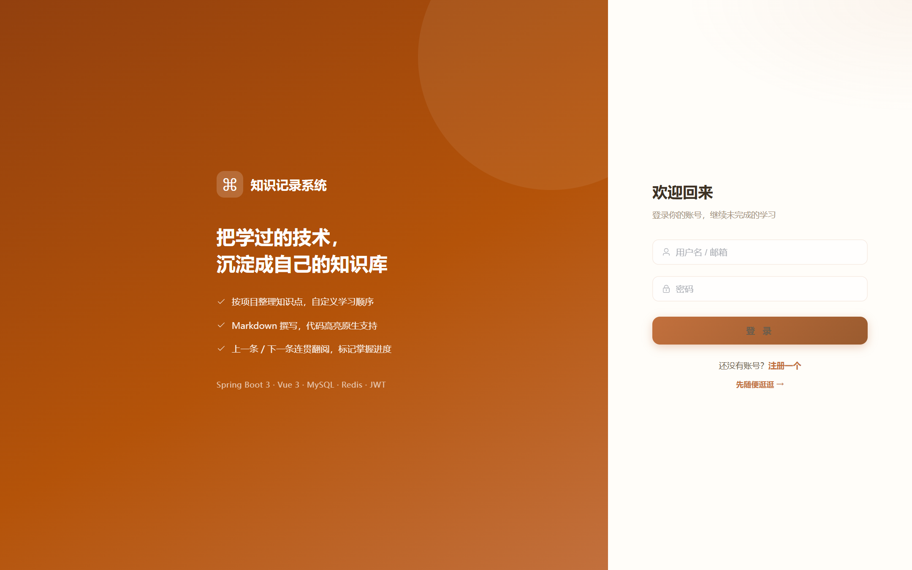
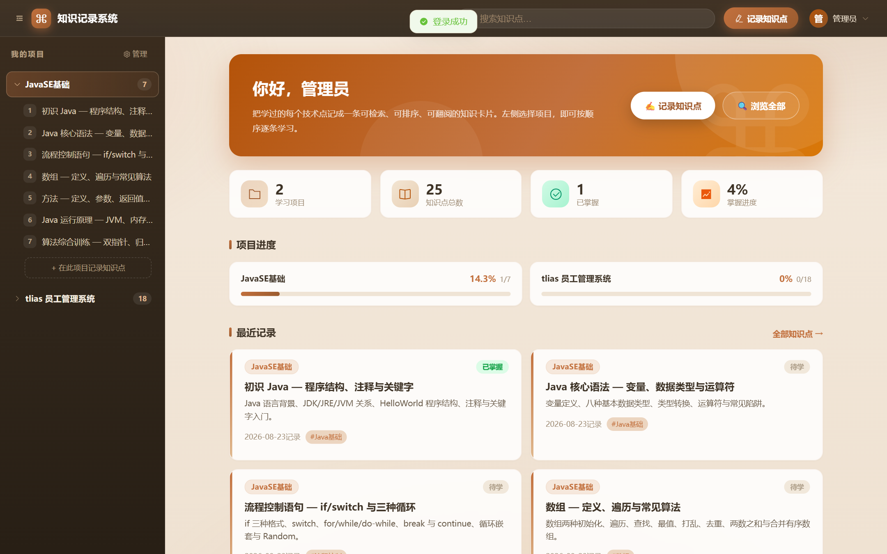
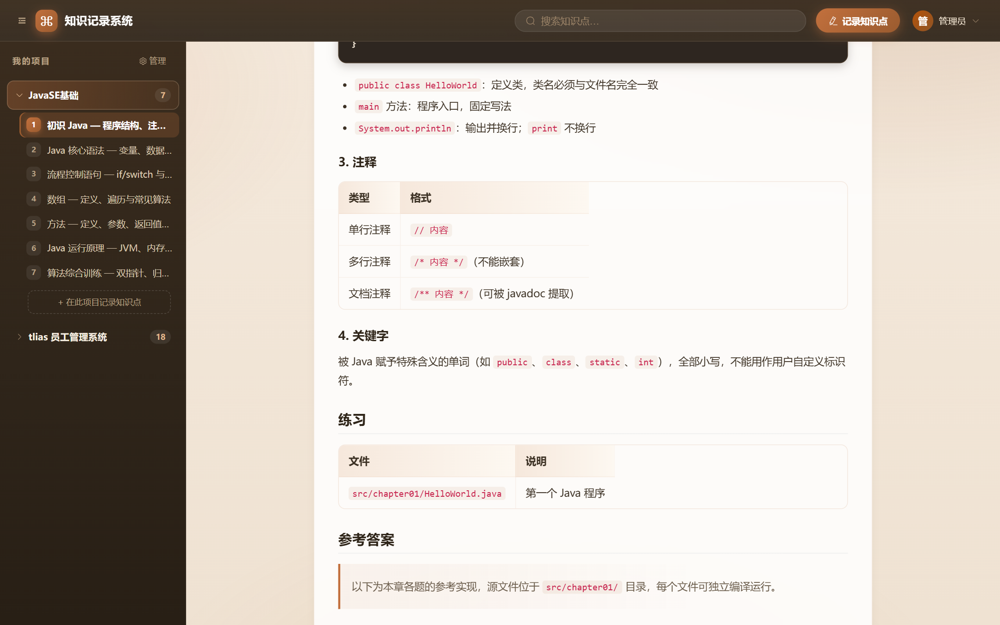
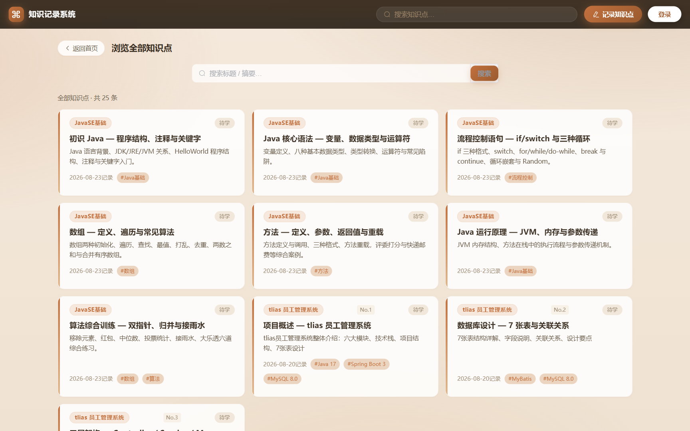

# CodeCraft · 个人技术知识库

一个用于**记录与回顾技术知识点**的全栈项目：按「项目 → 知识点」两级组织，支持 Markdown 撰写、自定义排序、上一条/下一条连贯翻阅、学习状态跟踪（待学 / 学习中 / 已掌握）与掌握进度统计。

## 技术栈

| 层 | 技术 |
|---|---|
| 后端 | Spring Boot 3 · Spring Security + JWT · MyBatis-Plus · Flyway · MySQL 8 · **Redis**（登录限流 / Token 黑名单 / 用户缓存） |
| 前端 | Vue 3 · Vite · Element Plus · Pinia · Vue Router · markdown-it + highlight.js + DOMPurify |
| 部署 | Docker Compose（mysql + redis + server + nginx） |

## 功能一览

- 🔐 注册 / 登录（双 Token：access 2h + refresh 30d，登出即拉黑；登录防爆破限流）
- 📁 项目（分类）与标签的完整 CRUD，侧边栏按序号排列
- 📝 知识点 CRUD：Markdown 编辑器（工具栏 + 实时预览）、排序序号、按项目分组
- ↩️ 详情页「上一条 / 下一条」导航，按项目内序号跳转
- 🎯 学习状态标记与掌握进度统计（首页看板 + 项目进度条）
- 🔍 全站搜索：默认浏览全部知识点，输入关键词即时筛选，分页浏览
- 🖼 双栏知识库布局 + 响应式卡片墙，奶油暖棕主题

## 界面

### 登录



### 首页（左目录 + 右内容，含统计看板）



### 知识点详情（Markdown 渲染 + 学习状态）



### 浏览全部（卡片墙 + 搜索筛选）



## 快速开始

```bash
# 前端静态资源先本地构建一次（nginx 挂载 dist）
cd codecraft-web && npm install && npm run build

# 一键启动全部容器（首次自动导入 docker/init 建库脚本，Flyway 负责后续迁移）
docker compose up -d --build

# 复制环境变量模板并填入自己的密钥（JWT 密钥建议用 openssl rand -hex 32 生成）
cp .env.example .env

# 访问 http://localhost:8090
# 管理员用户名 admin；未预设 JIANGMA_ADMIN_PASSWORD 时，首次启动随机生成密码并打印在 docker logs codecraft-server
```

后端本地开发：`cd codecraft-server && mvn spring-boot:run`（需本机 MySQL/Redis，用环境变量注入 MYSQL_URL / MYSQL_USERNAME / MYSQL_PASSWORD / REDIS_HOST / JIANGMA_JWT_SECRET；真实密钥只存本地 `.env`，仓库仅保留 `.env.example` 模板）。

## 项目结构

```
codecraft-community
├── codecraft-server          # Spring Boot 后端（controller / service / mapper / security）
│   └── src/main/resources/db/migration   # Flyway 迁移脚本（V1~V16）
├── codecraft-web             # Vue 3 前端（views / layouts / components / stores / api）
├── docker                    # nginx 配置、初始化 SQL、截图
└── docker-compose.yml        # mysql + redis + server + web(nginx)
```

## 设计说明

- **Redis 的三个用途**：登录/注册接口滑动窗口限流、登出后 JWT 黑名单、用户信息 5 分钟缓存（减少鉴权查库）
- **上一条/下一条**：`post.sort_order` 决定项目内顺序，留空自动按录入顺序排最后；相邻节点由单条 SQL（自连接 + COALESCE）取得
- **主动刷新 Token**：前端解析 JWT exp，临期 60s 内先刷新再发请求，避免 401 竞态；并发共享同一次刷新
- **逻辑删除**：MyBatis-Plus 全局 deleted 标记；项目下仍有知识点时禁止删除项目
